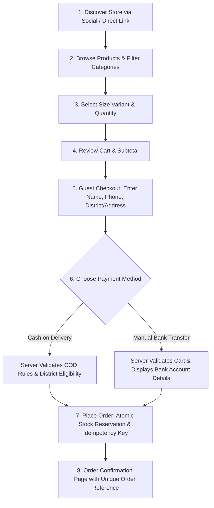

# ASPIREV TECHNOLOGIES — LOCAL E-COMMERCE PLATFORM
## Project Discovery, Functional Scope & Technical Architecture (Release 1.0)

[-black.svg)](https://nextjs.org/)
[](https://www.typescriptlang.org/)
[](https://supabase.com/)
[](https://vercel.com/)
[](https://tailwindcss.com/)

> **Confidential Working Document & Specification**  
> **Prepared by:** AspireV Technologies  
> **Prepared for:** Local Physical Retail / Kids Wear Client (Sri Lanka)  
> **Target Release:** First Production Release (Guest Checkout • Cash on Delivery • Manual Bank Transfer • Seller Admin Dashboard)

---

## 📌 01. Executive Summary & Working Assumptions

The objective of this project is to build a high-performance, mobile-first, and highly reliable e-commerce store for a Sri Lankan retail business selling physical products directly to local customers.

### Core Working Assumptions
| Item | Working Assumption | Status |
| :--- | :--- | :--- |
| **Business Model** | Direct-to-Consumer (single business sells products directly). | ✅ Confirmed |
| **Customer Sign-in** | **Not required.** Guest checkout is the default to maximize conversion and eliminate mobile checkout friction. | ✅ In Scope |
| **Payment Methods** | **Cash on Delivery (COD)** and **Manual Bank Transfer**. No automated third-party payment gateways in Release 1. | ✅ In Scope |
| **Bank Verification** | Manual verification by seller/admin upon bank statement confirmation. | ✅ In Scope |
| **Sales Area** | Sri Lanka (District & Town delivery zone rules with server-authoritative fees). | ✅ In Scope |
| **Fulfilment Flow** | Protected Seller Admin Dashboard to manage inventory, verify payments, and advance order states. | ✅ In Scope |
| **Hosting & Infra** | Next.js App Router on Vercel with managed Supabase PostgreSQL & Supabase Auth. | ✅ In Scope |

### First-Release Exclusions (Out of Scope for v1.0)
* No customer registration or mandatory user accounts.
* No automated online payment gateways (Stripe / PayHere / IPG) — to be priced in future phases.
* No multi-vendor / marketplace capabilities.
* No automated courier API integrations (e.g. PromptX, Pronto, Domex) — manual dispatch logging is used.
* No loyalty points, recurring subscriptions, or multi-currency catalogues.

---

## 🗺️ 02. Functional Scope & Website Page Map

```
Storefront & Admin Routes
├── / (Home)                       # Brand hero, featured categories, COD/delivery highlight, WhatsApp link
├── /products                      # Product catalog, category/age-group filters, stock status
├── /products/[slug]               # Gallery, variant/size options, real-time stock, COD checker, add-to-cart
├── /cart                          # Cart items review, quantity adjustments, estimated delivery fee
├── /checkout                      # Guest checkout form, district/town selection, COD vs Bank Transfer
├── /order-success/[id]            # Order reference, item snapshot, payment instructions (Bank/COD)
│
├── /admin/login                   # Restricted seller/staff sign-in (Supabase Auth)
├── /admin/dashboard               # Revenue metrics, pending bank transfers, orders ready to dispatch
├── /admin/products                # Catalog CRUD: images, SKUs, variants, prices, inventory
├── /admin/orders                  # Order processing, status transitions, search & filtering
├── /admin/payments                # Bank transfer verification, transaction ref logging, COD reconciliation
├── /admin/delivery                # District & zone fee configuration
└── /admin/settings                # Store profile, WhatsApp contact, approved bank instructions
```

---

## 🛍️ 03. Customer Journey (Browse-to-Order)



### Checkout Information Validation Rules
* **Customer Name**: Required plain text string.
* **Phone Number**: Required Sri Lankan mobile number format (e.g., `07X XXX XXXX` / `+94 7X XXX XXXX`).
* **Delivery Address**: Required full street address, district, and town used for server-side fee mapping.
* **Delivery Instructions**: Optional delivery note / landmark.
* **Payment Choice**: Strictly `COD` or `BANK_TRANSFER`.
* **Idempotency Token**: Client-generated unique UUID sent on checkout submission to prevent accidental duplicate orders on mobile double-taps.

---

## 💳 04. Business Logic & Payment Lifecycles

### Fulfilment Status vs. Payment Status Separation
To prevent operational errors, **Fulfilment Status** and **Payment Status** are strictly decoupled into independent lifecycles:

```
┌─────────────────────────────────┐       ┌─────────────────────────────────┐
│   ORDER STATUS (Fulfilment)     │       │        PAYMENT STATUS           │
├─────────────────────────────────┤       ├─────────────────────────────────┤
│ • pending_confirmation          │       │ • awaiting_transfer (Bank)      │
│ • confirmed / processing        │       │ • verification_pending (Bank)   │
│ • dispatched                    │       │ • paid (Verified by Admin)      │
│ • delivered                     │       │ • cod_pending (On Doorstep)     │
│ • cancelled / returned          │       │ • cod_collected (Cash Handed)   │
└─────────────────────────────────┘       └─────────────────────────────────┘
```

> **Operational Golden Rule:** Dispatching an order **never** automatically marks it as paid. A COD order is only marked `cod_collected` after the courier or delivery driver deposits the cash. A Bank Transfer order remains `awaiting_transfer` until an authorized admin explicitly verifies the funds against the actual bank statement.

### Atomic Inventory Reservation Policy
1. When an order is accepted, stock for each item variant is atomically decremented or reserved within a database transaction.
2. If an order is cancelled or expires prior to confirmation, the reservation is released **exactly once** to prevent stock leakage or overselling.

---

## 🏛️ 05. Software Architecture & Design Patterns (SADP)

The codebase implements a clean, layered architecture ensuring modularity, type safety, and testability:

```
src/
├── app/                                 # [Presentation / Next.js App Router]
│   ├── (shop)/
│   │   ├── page.tsx                     # Landing page with static pre-rendering (SSG)
│   │   ├── products/                    # Product catalog & [id] detail with size selection
│   │   ├── cart/                        # Cart with bill breakdown & COD threshold rules
│   │   ├── checkout/                    # Guest checkout form (COD vs Bank Transfer)
│   │   └── order-success/[id]/          # Confirmation screen with order snapshots
│   ├── admin/                           # Protected seller dashboard (Supabase Auth)
│   ├── api/
│   │   ├── orders/route.ts              # Route handler delegating to CheckoutFacade
│   │   └── pincode-check/route.ts       # Delivery zone & COD eligibility endpoint
│   ├── layout.tsx                       # Global layout with CartProvider & Navbar
│   └── globals.css                      # Tailwind styling tokens
│
├── core/                                # [Domain Layer] Pure Business Rules
│   ├── constants/
│   │   ├── CodRules.ts                  # COD limits, handling fee, and anti-fraud thresholds
│   │   └── KidsSizes.ts                 # Standardized kids sizing metrics
│   ├── entities/
│   │   ├── Product.ts                   # Product & Variant domain models
│   │   ├── Order.ts                     # Immutable Order entity with line snapshots
│   │   └── Cart.ts                      # Cart models and price aggregation
│   └── use-cases/
│       ├── CalculateOrderSummaryUseCase.ts # Subtotal, discounts, delivery & COD fee calculation
│       └── ValidateCodEligibilityUseCase.ts # Zone & value anti-fraud validation
│
├── infrastructure/                      # [Infrastructure & Design Patterns Layer]
│   ├── database/
│   │   └── DatabaseClient.ts            # [Singleton Pattern] Central persistence instance
│   ├── repositories/
│   │   ├── IProductRepository.ts        # [Repository Pattern] Product catalog interface
│   │   ├── MockProductRepository.ts     # In-memory/Postgres repository implementation
│   │   ├── IOrderRepository.ts          # Order storage interface
│   │   └── MockOrderRepository.ts       # Order persistence implementation
│   └── patterns/
│       ├── creational/
│       │   ├── OrderBuilder.ts          # [Builder Pattern] Step-by-step order construction
│       │   └── PaymentFactory.ts        # [Factory Pattern] Resolves COD vs Bank Transfer
│       ├── structural/
│       │   ├── CheckoutFacade.ts        # [Facade Pattern] Orchestrates end-to-end checkout
│       │   └── PincodeServiceAdapter.ts # [Adapter Pattern] Adapts delivery zones & logistics
│       └── behavioral/
│           ├── payment-strategies/
│           │   ├── IPaymentStrategy.ts
│           │   ├── CashOnDeliveryStrategy.ts # [Strategy Pattern] Doorstep COD logic
│           │   └── BankTransferStrategy.ts   # [Strategy Pattern] Manual transfer instructions
│           └── events/
│               └── OrderEventDispatcher.ts   # [Observer Pattern] Dispatches order placed events
│
├── presentation/                        # [Presentation Layer] UI Components & Client State
│   ├── components/
│   │   ├── atoms/                       # CodBadge, PriceTag
│   │   ├── molecules/                   # SizeSelector, PincodeChecker, ProductCard
│   │   └── organisms/                   # Navbar, Footer, CodCheckoutForm
│   ├── context/
│   │   └── CartContext.tsx              # React Context with LocalStorage persistence
│   └── hooks/
│       └── useCart.ts                   # Cart access hook
│
└── shared/                              # [Cross-Cutting Layer]
    ├── types/common.ts                  # Enums (PaymentMethod, OrderStatus, AgeGroup, etc.)
    └── utils/currency.ts                # LKR currency formatter
```

---

## 🗄️ 06. Data Model & Database Architecture (Supabase PostgreSQL)

| Table / Entity | Key Columns | Purpose |
| :--- | :--- | :--- |
| `profiles` | `id (UUID FK Auth)`, `display_name`, `role`, `active` | Admin & staff access permissions. |
| `categories` | `id`, `name`, `slug`, `sort_order`, `active` | Product groupings. |
| `products` | `id`, `slug`, `title`, `description`, `category_id`, `mrp`, `selling_price`, `fabric`, `active` | Base product information. |
| `product_variants`| `id`, `product_id`, `sku`, `size`, `color`, `stock_on_hand` | Inventory management unit. |
| `product_images` | `id`, `product_id`, `storage_path`, `sort_order` | Supabase Storage media references. |
| `orders` | `id`, `public_reference`, `customer_name`, `phone`, `address_snapshot`, `payment_method`, `order_status`, `payment_status`, `subtotal`, `delivery_fee`, `cod_fee`, `grand_total`, `created_at` | Unique purchase records (Guest & Admin). |
| `order_items` | `id`, `order_id`, `variant_id`, `title_snapshot`, `sku_snapshot`, `size_snapshot`, `unit_price`, `quantity`, `line_total` | **Immutable snapshots** at order time. |
| `payment_records` | `id`, `order_id`, `method`, `amount`, `status`, `bank_ref`, `verified_by`, `verified_at` | Audit trail for manual payments & COD collection. |
| `delivery_zones` | `id`, `district`, `town`, `standard_fee`, `cod_available`, `estimated_days`, `active` | Server-authoritative delivery calculations. |
| `inventory_movements`| `id`, `variant_id`, `order_id`, `quantity`, `type (RESERVED/SOLD/RESTOCKED)`, `created_at` | Traceable stock audit log. |
| `order_status_history`| `id`, `order_id`, `from_status`, `to_status`, `actor_id`, `reason`, `created_at` | Order lifecycle change history. |
| `store_settings` | `key`, `value_json` | Bank details, WhatsApp number, store policies. |

### Data Integrity Rules
* **Snapshot Protection**: Line item titles, SKUs, and prices are frozen inside `order_items` at checkout. Future price changes in the catalogue never alter past invoices.
* **Exact Money Representation**: All currency calculations use PostgreSQL `NUMERIC(12,2)` or integer units (cents/rupees). Floating-point math is strictly forbidden.
* **Row Level Security (RLS)**: Public client access is strictly read-only for active products and insert-only for orders via authenticated server-side handlers. Customer orders and admin settings are protected by RLS policies.

---

## 🛡️ 07. Risk Prevention & Logical Failure Safeguards

| Failure Mode | Root Cause | AspireV Architectural Solution |
| :--- | :--- | :--- |
| **Price Tampering** | Client submits manipulated total in HTTP payload. | **Server-Authoritative Pricing**: Client submits only variant IDs and quantities. The server looks up database prices and calculates all totals. |
| **Duplicate Order on Double-Tap** | Customer taps "Submit" repeatedly on mobile network latency. | **Idempotency Key**: Checkout requests send a unique client token. Duplicate submissions return the original existing order. |
| **Overselling Last Item** | Two concurrent checkouts read the same stock. | **Atomic Database Transactions**: Stock decrement/reservation runs inside a PostgreSQL `SERIALIZABLE` transaction with row-level locks. |
| **Silent Zero Shipping** | User enters unmapped town or unconfigured district. | **Server Fallback Check**: If delivery destination does not match an active zone, the server blocks checkout with a clear notice rather than charging zero. |
| **Customer Data Leakage** | Guessable sequential IDs (e.g., `/orders/123`). | **Secure Public Tokens**: Orders use cryptographically random public references (`KW-849201`) with rate-limited endpoints. |
| **Admin API Vulnerability** | Direct API mutation calls bypassing UI buttons. | **Session + Role Enforcement**: Server Actions and API handlers verify Supabase Auth admin JWTs before executing changes. |

---

## 🧪 08. Quality Gates & Acceptance Test Plan

Before production sign-off, the following test scenarios must be verified on Staging:

| Test Case | Expected Behavior | Criticality |
| :--- | :--- | :--- |
| **Place COD Order** | Order created; item snapshots stored; status `pending_confirmation`; payment `cod_pending`. | **Critical** |
| **Place Bank Transfer Order** | Order created; bank details displayed; payment `awaiting_transfer`; stock reserved. | **Critical** |
| **Price Tampering Attack** | Manipulated prices in request body are discarded; server recalculates exact database price. | **Critical** |
| **Double Submit / Refresh** | Rapid repeated taps create exactly **one** order record; no duplicate financial transactions. | **Critical** |
| **Concurrent Last-Item Race** | When 1 unit remains, first customer succeeds; second customer is gracefully rejected with out-of-stock notice. | **Critical** |
| **Invalid District / Unserviceable Area** | Checkout blocks submission and prompts customer for assistance; no zero-fee bypass. | **Critical** |
| **Unauthenticated Admin Call** | Direct HTTP POST/PATCH to `/api/admin/*` returns `401 Unauthorized`. | **Critical** |
| **Admin Verify Bank Transfer** | Verifier ID, timestamp, and bank reference recorded in audit log; order advances to `confirmed`. | **Critical** |
| **Order Cancellation Restock** | Cancelling an unfulfilled order releases reserved stock back to `stock_on_hand` exactly once. | **Critical** |

---

## 💻 09. Development & Deployment Guide

### Prerequisites
* **Node.js**: v20.x or higher
* **npm**: v10.x or higher

### Local Development
```bash
# 1. Install dependencies
npm install

# 2. Run the development server
npm run dev
```
Open [http://localhost:3000](http://localhost:3000) to view the storefront.

### Production Build & Verification
```bash
# Compile and test all TypeScript types, routes, and Next.js bundles
npm run build

# Start production server locally
npm run start
```

### Deployment to Vercel
1. Push repository changes to GitHub (`main` branch).
2. Connect the repository in the **Vercel Dashboard**.
3. Configure environment variables in Vercel:
   - `NEXT_PUBLIC_SUPABASE_URL`
   - `NEXT_PUBLIC_SUPABASE_ANON_KEY`
   - `SUPABASE_SERVICE_ROLE_KEY` (Server-only; never exposed to browser)
4. Deploy — Vercel automatically deploys the Next.js App Router with edge-cached SSG routes and serverless execution for APIs.

---

## 📝 10. Document Ownership & Acknowledgement

* **Prepared by**: AspireV Technologies Engineering Team
* **Status**: Planning & Discovery Specification (v1.0)
* **Client Handover**: Includes full source repository, admin operational quickstart, database migration scripts, and Vercel hosting configuration.
